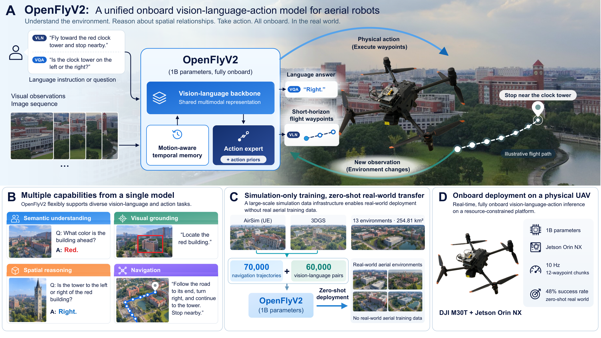

# OpenFlyV2: An onboard vision-language-action model for aerial perception and navigation

OpenFlyV2 unifies aerial perception and navigation in a single onboard vision-language-action model, supporting semantic understanding, language-grounded perception, spatial reasoning, and continuous aerial control.

<a href="assets/figure1.pdf">View Figure 1 as PDF</a>

## Abstract

Human cognition flexibly draws on a shared perceptual foundation to understand environments, attend to referenced entities, reason about spatial relationships, and act. Endowing aerial robots with an analogous functional organization remains challenging, as existing systems are often specialized for individual capabilities, dependent on offboard computation, or unable to sustain closed-loop operation on resource-constrained platforms. We present OpenFlyV2, a unified onboard vision-language-action architecture that uses a shared vision-language representation to support semantic understanding, language-grounded perception, spatial reasoning, and continuous aerial control within a single model. A compact action expert converts the shared multimodal context into short-horizon flight waypoints, while motion-aware temporal memory and action priors reduce the computational cost of closed-loop execution. We construct AeroBrain, a simulation-based dataset comprising approximately 70,000 navigation trajectories and 60,000 vision-language instruction–response pairs. OpenFlyV2 generates action chunks, each comprising 12 waypoints, entirely onboard at 10 Hz using an NVIDIA Jetson Orin NX. It transfers zero-shot from simulation to physical quadrotor flight, achieving a 48% navigation success rate across four real-world environments without real-world aerial training data. Extensive results demonstrate that broad vision-language competence and continuous closed-loop flight can coexist within a single model on a resource-constrained aerial platform.

## Highlights

- **Unified perception and action.** A shared vision-language representation supports semantic understanding, language-grounded perception, spatial reasoning, and continuous aerial control.
- **Efficient closed-loop execution.** A compact action expert, motion-aware temporal memory, and action priors enable onboard generation of 12-waypoint action chunks at 10 Hz on an NVIDIA Jetson Orin NX.
- **Simulation-based training.** AeroBrain comprises approximately 70,000 navigation trajectories and 60,000 vision-language instruction–response pairs.
- **Zero-shot real-world transfer.** OpenFlyV2 achieves a 48% navigation success rate across four real-world environments without real-world aerial training data.

## Dataset

The **AeroBrain** dataset is available on Hugging Face:

**[🤗 Ideallll/AeroBrain](https://huggingface.co/datasets/Ideallll/AeroBrain)**

> **Data availability:** The dataset described in the paper spans 13 environments. Two GS Ruins environments are currently excluded from the public release due to privacy concerns.

## Release status

We are preparing the OpenFlyV2 open-source release. Code, model checkpoints, and usage instructions are coming soon.
